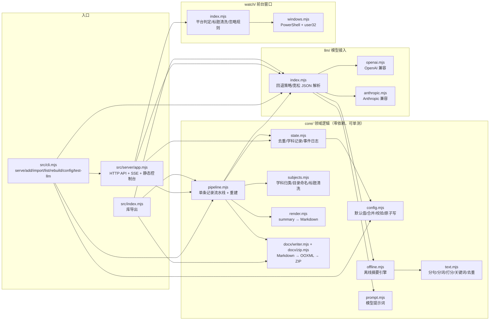
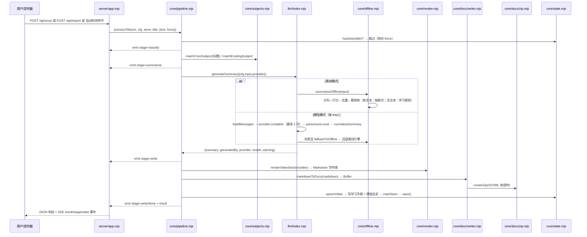

# 架构说明

本文说明离线学习笔记助手的模块划分、一次「整理一条学习记录」的完整数据流，以及几个刻意的设计取舍（尤其是「为什么 Word 不用 python-docx」）。

所有结论都以 `src/` 下的实际实现为准；文中提到的文件路径可以直接对照代码。

## 1. 总览



依赖方向是单向的：`server/` `cli.mjs` → `core/` `llm/` `watch/`，`core/` 不反向依赖 `server/`（`src/index.mjs` 只是统一再导出）。所以核心逻辑可以在没有 HTTP 服务的情况下直接调用和测试。

## 2. 一次处理的完整数据流



逐步对应代码：

| 阶段 | 代码位置 | 说明 |
| --- | --- | --- |
| 入口 | `server/app.mjs` `processCurrent()` / `cli.mjs` `appProcess()` | 两条入口都调用同一个 `processTitle()`；同一时刻只允许一个任务（`running` 标志） |
| 去重 | `pipeline.mjs` + `state.mjs` `hasSeen()` | 标题归一化：小写、去掉空白/标点/符号；`force` 可跳过 |
| 分类 | `subjects.mjs` `matchCoreSubject()` | 预设学科（`subjects.core`）的别名表匹配，取**最长命中别名**（避免「数学」抢掉「高等数学」）；未命中再看是否包含已有学科名；否则归入 `待分类`。学科名即目录名，所有学科同级（没有额外分组） |
| 摘要 | `llm/index.mjs` `generateSummary()` | 离线/模型统一入口，返回固定 `summary` 结构 |
| 渲染 | `render.mjs` `renderVideoSection()` | 固定章节顺序：内容信息 → 核心知识点 → 重点概念与公式 → 学习重点 → 易错点 → 复习自测 → 思维导图（mermaid） |
| Word | `docx/writer.mjs` `markdownToDocx()` | Markdown → 块解析 → OOXML 段落 → ZIP Buffer |
| 落盘 | `pipeline.mjs` `writeUtf8()` + `tryWriteDocx()` | Markdown 必须成功；Word 失败**不阻断**流程，错误写事件日志并在结果里带 `docxError` |
| 汇总 | `pipeline.mjs` 第 4 步 | 该学科 `学习手册.md/.docx`（所有条目合集）+ 输出根目录 `课程总览.md/.docx`（`renderOverview(store)` 列出所有学科与最近更新） |
| 状态 | `state.mjs` `markSeen/upsertVideo/save()` | 原子写（临时文件 + rename），同步写避免与轮询竞争；`events.jsonl` 追加事件 |
| 通知 | `server/app.mjs` `emit`/`broadcast` | `ctx.onEvent` → `live.stage` → SSE `stage`；结果 → SSE `result`；结束 → SSE `state` |

### 摘要数据结构

两条生成路径产出同一个结构，因此渲染层与 Word 生成只有一份实现：

```js
{
  overview: string,               // 一句话导语
  knowledgePoints: [{ point, detail }],
  keyTerms: [{ term, explain }],
  studyTips: string[],            // 学习重点（渲染为「### 学习重点」）
  pitfalls: string[],
  reviewQuestions: string[],
  mindmap: { title, children: [{ title, children: [{ title }] }] },
  generatedBy: 'offline' | 'llm',
}
```

模型返回的任意 JSON 会先经过 `normalizeSummary()` 归一化（容忍字段别名 `summary/keyPoints/terms/explain/...`、字符串数组混用、层级越界），再进入渲染。早期版本的旧 tips 字段会被当作 `studyTips` 的别名兼容读取。

## 3. 离线引擎（core/text.mjs + core/offline.mjs）

两条路径，全部是**确定性纯函数**（相同输入必得相同输出）：

1. **有可用材料**（长度 ≥ 20、分句 ≥ 3、且像正常学习文本）→ **抽取式摘要**：
   - `splitSentences()` 按中英文句末标点/换行/分号切句，去列表前缀、去重；
   - `rankSentences()` 给句子打分：标题命中 + 关键词共现密度（用「出现在多少句里」的 DF 而不是词频）+ 位置加权（首句 1.0、次句 0.6…末句 0.2）+ 长度惩罚；
   - `extractKeywords()` 用中文 2~4 字滑窗 + 英文词 + 数字统计候选词，过滤停用词/虚词边界，按「词频 × 词长」排序并用字符集合 Jaccard 去重叠；
   - 知识点 = 高分句子提炼成短标题（去口头填充词、取含标题词项的子句、不足 12 字向后拼接），不足 8 条时用逗号子句、再用术语补足，最后 `dedupeBySimilarity()`（阈值 0.82）去重；
   - 术语抽取：书名号/引号内容 + 「XX函数/定理/法则/机制…」后缀模式 + 高频词 + 标题词 + 用户关键词；解释取原文包含该词的句子片段（找不到就明确写「原文未直接展开」）；
   - 学习重点句 = 含提示词 `考点|常考|必考|重点|难点|分值|题型|考核|考查` 的句子；易错句 = 含 `易错|容易混|误区|混淆|陷阱|注意区分|…` 的句子。这些词只是**识别用户材料里的重点句**，输出不预设任何考试大纲/分值/题型框架（章节名固定为「学习重点」）；
   - 自测题按固定模板套知识点；思维导图 = 前 6 个知识点作一级节点 + 其 `detail` 子句作二级节点。
2. **没有材料 / 材料过短** → **学习框架模板**：输出 9 个固定角度的知识点（学习目标与范围定位、核心概念与关键词、公式与符号含义、按学科切换的「解题/训练/操作/学习步骤」、典型例题与变式、重点内容与常见形式、易错点与易混淆概念、自测与复习安排、与前后章节的联系），并按学科名切换步骤措辞。导语明确写「离线模板整理（未接入大模型）」，并区分「未获取到材料」与「材料过短」两种情况，避免用户误以为导入内容被丢弃。

可调参数（默认值在 `config.mjs` 的 `DEFAULTS.offline` 里，改 `config/config.json` 的 `offline` 块即可覆盖）：

```json
{
  "offline": {
    "maxTextChars": 20000,
    "maxPoints": 20,
    "maxKeyTerms": 10
  }
}
```

## 4. 为什么 Word 生成不用 python-docx

`src/core/docx/` 是**纯 JS 的 OOXML + ZIP 实现**，`package.json` 里没有任何 `dependencies`。原因：

1. **零依赖是产品前提**：目标用户是普通学习者，多数机器上只有 Node（甚至只是被别的工具顺带装上的），没有 Python、没有 pip、没有 Office 编程接口。要装 python-docx，就得先装 Python + 依赖，还得处理国内 pip 源、虚拟环境、权限——这比「离线可用」的卖点更劝退。
2. **不依赖 Office/WPS 被安装**：用 COM 自动化（`Word.Application`）生成 docx 要求本机装了 Word；LibreOffice 转换又要额外几百 MB。自己拼 OOXML 只需要写到磁盘。
3. **可控的确定性输出**：`markdownToDocx()` 是纯函数（Markdown 字符串 → Buffer），无进程、无临时文件、无并发冲突，测试里可以直接断言 ZIP 内的 `word/document.xml` 结构。COM/LibreOffice 路线不可单测、不可并行、CI 里也跑不起来。
4. **只做需要的子集**：本项目生成的 Markdown 来自 `render.mjs`，格式稳定且有限。需要支持的块只有标题、段落、引用、列表、代码块、分隔线、mermaid mindmap——用约 1000 行 OOXML 生成器覆盖，比引入一整条 Python 工具链划算。
5. **中文排版是硬需求**：自己写样式可以精确设置 `w:eastAsia="宋体"`（西文 Calibri、代码 Consolas），并在 ZIP 里用 UTF-8 文件名（通用标志位 bit 11），保证 Word/WPS 打开中文不乱码、不乱码成方框。

实现要点：

- `docx/zip.mjs`：自己实现 ZIP32（本地文件头 + 中央目录 + EOCD）、CRC32、`node:zlib` 的 `deflateRawSync`/`inflateRawSync`；同时提供 `readZip()` 供测试与冒烟脚本解包校验。
- `docx/writer.mjs`：`parseMarkdown()` 把 Markdown 解析成块，再分别渲染；`mermaid mindmap` 代码块会被识别并转成 **Word 原生分级大纲**（根节点加粗 `MindmapRoot` 样式，子级用多级编号缩进 + `w:outlineLvl`），而不是把源码贴进文档。
- 固定的 8 个 OOXML 部件：`[Content_Types].xml`、`_rels/.rels`、`word/document.xml`、`word/styles.xml`、`word/numbering.xml`、`word/_rels/document.xml.rels`、`docProps/core.xml`、`docProps/app.xml`。
- 代价：不支持图片、表格、脚注、批注等高级排版；H4~H6 统一降为标题 3；列表最多 3 级；mindmap 大纲最多 9 级。

## 5. 服务层（src/server/app.mjs）

`createApp({configPath, port, openBrowser, singleInstance})` 返回 `{start, close, snapshot}`，内部状态都在闭包里，便于测试与进程内复用。

- **单实例**：启动时读 `data/server.json` 的 `port` 并请求 `/api/health`；有响应就只打开浏览器并返回 `{existing:true}`，不重复监听。
- **端口顺延**：`pickPort(host, start, attempts=20)` 用 `node:net` 逐个试听，遇 `EADDRINUSE`/`EACCES` 就 +1，最多 20 次。
- **轮询**：`setTimeout` 自排程（不是 `setInterval`），每轮 `observe()` → 读前台窗口 → 判定 → `broadcast('tick')` → `schedule()`；`enabled` 关闭或平台不支持时 `nextTickAt = 0`。
- **稳定判定**：同一标题连续 `stablePolls` 次命中才处理，防止切页面时误触。
- **任务串行**：`running` 为真时新的 `/api/scan` 直接返回「正在处理中」，不会并发写同一个文件。
- **SSE**：`clients` 是 `Set<res>`，`broadcast()` 直接 `res.write`；15 秒一次 `: ping` 保活；`req.on('close')` 清理。
- **安全边界**：只监听 `127.0.0.1`；静态文件解析后必须落在 `src/server/static/` 内；`/api/open` 只允许 `outputDir`/`dataDir` 下的路径（大小写不敏感比较）；请求体上限 1MB。
- **配置热更新**：`applyConfig()` 只接受白名单字段 → `updateConfigFile()` 校验并原子写 → 重建 provider → 重排定时器；校验失败不落盘。

## 6. 可测试性设计

- **纯函数优先**：`text.mjs`、`offline.mjs`、`render.mjs`、`docx/writer.mjs`、`docx/zip.mjs`、`subjects.mjs` 都是无 I/O 或只做内存操作的纯逻辑，能直接断言。
- **可注入配置**：`loadConfig({configPath, env})` 允许指定配置文件与「假环境变量」，测试不会读到真实 `config/config.json`；`DEFAULTS` 被 `structuredClone` 后再合并，测试之间互不污染。
- **依赖注入**：`processTitle(ctx, cfg, store, title, options)` 的 `ctx` 里带 `logger` / `provider` / `onEvent`，因此可以不联网、不建 provider 地跑完整流水线；`StateStore(dataDir)` 只依赖目录，测试用 `mkdtemp` 临时目录。
- **本地假服务**：`tests/llm.test.mjs` 用 `node:http` 起随机端口的假 OpenAI/Anthropic 服务，断言 URL、鉴权头、请求体与解析结果；不发真实请求、不需要 API Key。
- **端到端冒烟**：`scripts/smoke.mjs` 在临时目录里离线生成 4 条示例记录（数学 / Python / 英语 / 摄影，含「只有标题、无导入材料」的场景），校验 Markdown 章节、Word 是否为 `PK` ZIP、`word/document.xml` 结构、手册与总览是否生成。
- **CI**：`.github/workflows/ci.yml` 在 Ubuntu 与 Windows 上跑 Node 20/22，执行 `node --test` + `node scripts/smoke.mjs`。

## 7. 状态与文件布局

`state.json`（`STATE_VERSION = 1`）：

```json
{
  "version": 1,
  "lastTitle": "",
  "lastRunAt": 0,
  "seen": { "<归一化标题>": { "ts": 0, "title": "原文标题", "subject": "数学" } },
  "subjects": { "数学": { "createdAt": 0, "updatedAt": 0, "videos": [] } },
  "updatedAt": 0
}
```

- `seen` 最多保留 800 条（超出按 `ts` 淘汰最旧）。
- `videos[]` 每条记录含标题、学科、关键词、`summary`、生成方式/模型、`inputChars`、笔记与手册路径、时间戳。
- `events.jsonl` 每行一个事件：`classify`、`note-written`、`docx-error`、`docx` 等，用于事后排查。
- `writeUtf8`/`atomicWriteJson`/`atomicWrite` 都是「同目录临时文件 + rename」，避免半截文件。

输出目录（扁平，学科即一级目录，由 `subjects.mjs` 的 `subjectDir()` / `noteDir()` 拼出）：

```text
<outputDir>/
├── 课程总览.md / .docx          # 所有学科 + 最近更新
└── <学科>/
    ├── 学习手册.md / .docx      # 该学科所有条目的合集
    └── 单集笔记/YYYY-MM-DD_<标题>.md / .docx
```

没有「核心/其他」这类中间层；学科名经 `safeName()` 清理后直接作为目录名，未命中任何别名的记录统一进 `待分类` 学科。

## 8. 扩展点

| 想做的事 | 改哪里 |
| --- | --- |
| 新增学科或改别名 | `config/config.json` 的 `subjects.core`（无需改代码） |
| 改笔记章节/文案 | `core/render.mjs`（Markdown 结构固定后 Word 会跟着变） |
| 换离线抽取策略 | `core/offline.mjs` + `core/text.mjs`（保持返回结构不变） |
| 接入新协议 | 在 `llm/` 新增 provider（实现 `{id,label,mode,hasAuth(),complete(),listModels()}`），在 `llm/index.mjs` 注册 |
| 改提示词 | `core/prompt.mjs`（输出必须仍是约定的 JSON 结构） |
| 新增 HTTP 接口 | `server/app.mjs` `handle()` 的 `if (pathname === ...)` 分支（同时更新 `docs/API.md`） |
| 加 Word 特性 | `core/docx/writer.mjs`（块解析 + 样式 + numbering 三处） |
